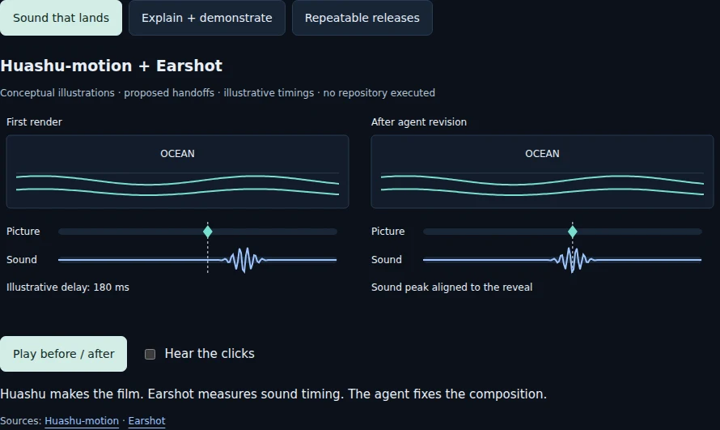

# AI Video Editing Tools

**[Open the live interactive guide](https://az9713.github.io/ai-video-editing-tools/)** · **[Jump to the three animated workflows](https://az9713.github.io/ai-video-editing-tools/#combinations)**

A dark-mode, illustrated guide to eight open-source video and animation repositories: what each does, how it works, setup requirements, limitations, and when to use it.

Inspired by the **[original AI Labs YouTube video](https://www.youtube.com/watch?v=oTWUyW_bR-g)**. The guide uses its transcript and adds research from the repositories' documentation, skill instructions, and selected implementation files. Source links and video chapter timestamps appear throughout the guide.

## Our contribution: three workflows combining multiple repositories

Our original contribution is **three practical example workflows that combine selected repositories from the eight**, with interactive SVG and JavaScript animations explaining each tool's contribution and the handoff between them.

| Workflow | Tools | What the combination adds |
| --- | --- | --- |
| Sound that lands | **Huashu-motion + Earshot** | Create a product film, inspect audio timing, and use that evidence to align sound with visual events. |
| Explain and demonstrate | **Argo + Explainroo** | Combine recordings of the real software workflow with conceptual diagrams and one coordinated narration. |
| Repeatable releases | **Argo + Huashu-motion** | Rerun a browser capture as the app changes, replace the product clip, and reuse the branded intro and ending. |

Select a workflow and press **Play**. The first example includes optional synthesized clicks to make the timing difference audible.

*Preview of the guide's conceptual illustrations. Open the live guide for playback.*

These workflows are proposed compositions based on documented capabilities, not built-in integrations or end-to-end pipelines tested in this project. The animations are explanatory illustrations, not recordings of the upstream tools running. Illustrative timing values are labeled.

## The eight upstream repositories

1. [Huashu-motion](https://github.com/alchaincyf/huashu-motion) — editable, music-led product films.
2. [Rossark Motion Skill](https://github.com/rossark0/rossark-motion-skill) — believable animation for drawings, mascots, and app illustrations.
3. [Take One](https://github.com/talsiach/take-one) — a creative production workflow for short films, with fresh review.
4. [Reanimate](https://github.com/NiazMorshed2007/reanimate) — measure and reproduce reference animations in your own project.
5. [Argo](https://github.com/shreyaskarnik/argo) — browser-driven product recordings with narration and overlays.
6. [Explainroo](https://github.com/vincentsch/explainroo) — narrated explainers whose visuals follow spoken-word timing.
7. [Video Director](https://github.com/win4r/video-director) — directing guidance and technical video checks.
8. [Earshot](https://github.com/Leonxlnx/earshot) — audio analysis, timing evidence, and sound-design tools for agents.

The upstream creators own and maintain their projects; this repository provides an educational guide and our combination examples.

## View locally

Clone or download this repository and open `index.html` in a browser. Keep the `assets/` directory beside it. No build step, API key, package installation, or backend is needed. External source links require internet; the guide, animations, and embedded local assets work offline.

The site is published with GitHub Pages from the root of the `main` branch. `.nojekyll` keeps publication static.

## Sources and verification

- Research snapshot: **2 November 2026**. Upstream requirements and features may change.
- The four source visuals link to their original repository assets in the guide. The preview above is a screenshot of our guide.
- The interactive examples were checked for playback, optional click audio, offline operation, and layouts down to 320 pixels wide.
- The eight upstream production pipelines were researched, not executed or benchmarked here.
- Upstream code, models, fonts, recordings, and artwork retain their respective licenses and attribution requirements.
